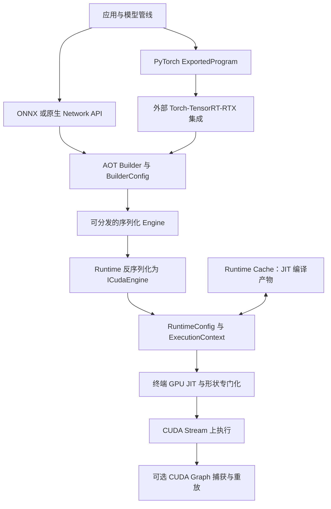

# TensorRT-RTX 整体架构与源码阅读

## 1. 核查范围与基线

- 日期：2026-11-19（Asia/Shanghai）。
- 仓库：`https://github.com/NVIDIA/TensorRT-RTX.git`。
- 本地位置：`nvidia/third_party/TensorRT-RTX/`。
- SHA：`cbffacf00c7d681bb31793e5413463e836af10d3`，提交标题 `TensorRT-RTX 1.7 Release`。
- 研究输入：NVIDIA RTX PC、TensorRT-RTX；示例模型为小型 FC 网络、FLUX.1/FLUX.2；不是 vLLM 后端接入审查。
- 权威主题对应：[54：执行模式分类](../../20260903-vllm-ai-infra-research/05-vllm-compile/20260903-54-Eager、JIT、AoT、Trace与Replay.md)、[52：图捕获与 Shape](../../20260903-vllm-ai-infra-research/05-vllm-compile/20260903-52-CUDAGraph、PiecewiseCapture与Shape.md)。本文属于厂商补充记录，不扩充 105 篇 Manifest 或 Claim 索引。
- 成熟度：公开调用代码 `SOURCE_IMPLEMENTED × STATIC_REVIEWED`；闭源 SDK 行为以官方 API 文档契约为证，不等于已检查内部实现；无 GPU 运行证据。

主路线是 **AOT + JIT**；研究评级 **★★★☆☆**，依据为已发布 SDK 与示例、API 契约完备到可核查调用链，但本机未做设备验证。CUDA Graph 是其下游可选执行优化，不替代 AOT/JIT。

## 2. 仓库实际提供什么

本次先检查仓库规则与文档：没有独立 `AGENTS.md` 和顶层 `doc/`、`docs/`；优先阅读根 README、samples 子目录 README 与官方架构页。根 [README](../third_party/TensorRT-RTX/README.md) `L8-L10` 明确要求另行下载 SDK，GitHub 包含其配套开源组件。

| 开源目录 | 职责 | 推荐入口 |
| --- | --- | --- |
| `samples/helloWorld/` | 最小网络定义、ONNX 解析、构建、反序列化与执行 | [hello_world.py](../third_party/TensorRT-RTX/samples/helloWorld/python/hello_world.py) |
| `samples/apiUsage/` | GPU 目标、动态 shape、refit、runtime cache、CUDA Graph | [api_usage.py](../third_party/TensorRT-RTX/samples/apiUsage/python/api_usage.py) |
| `samples/memoryManagement/` | 自定义 allocator、静态与用户管理的 context 内存 | [memory_management.py](../third_party/TensorRT-RTX/samples/memoryManagement/python/memory_management.py) |
| `demo/utils/` | 真实模型的 Engine、Pipeline、缓存与内存编排 | [engine.py](../third_party/TensorRT-RTX/demo/utils/engine.py)、[pipeline.py](../third_party/TensorRT-RTX/demo/utils/pipeline.py) |
| `demo/flux1.dev/` | FLUX.1 模型管线，含 ONNX 与原生网络构建路径 | [README](../third_party/TensorRT-RTX/demo/flux1.dev/README.md) |
| `demo/flux2/` | PyTorch export 后经外部 Torch-TensorRT-RTX 包编译 transformer | [flux2_pipeline.py](../third_party/TensorRT-RTX/demo/flux2/flux2_pipeline.py) |

`samples/CMakeLists.txt:L19-L27` 从外部 `TRTRTX_INSTALL_DIR` 读取 SDK 的 include/lib；克隆这个仓库不能从源码构建完整编译器和 runtime。

## 3. 分层架构



这是公开接口的逻辑分层，不是闭源 SDK 内部模块图。JIT 工作分布在执行上下文创建及后续推理阶段，尤其是动态形状首次出现时；不能将所有编译固定理解为只发生在 `create_execution_context` 或只发生在首个 enqueue。

## 4. 从模型到 GPU 的调用链

### 4.1 前端：将模型描述为网络

- 原生 API：`hello_world.py:L48-L86` 创建 strongly typed 网络，依次添加 input、constant weights、matrix multiply、ReLU、output。
- ONNX：`hello_world.py:L91-L116` 创建同样的 network，通过 `OnnxParser.parse_from_file` 导入。
- PyTorch：`flux2_pipeline.py:L517-L553` 使用 `torch.export.export` 捕获 transformer，交给 `torch_tensorrt.dynamo.compile`，然后替换 Diffusers 管线中的 transformer。编译集成来自外部依赖，不能据此声称其内部实现位于此仓库。

### 4.2 AOT：生成可分发 Engine

`hello_world.py:L129-L158` 的 `create_serialized_engine`：

```text
Builder -> create_builder_config
        -> create_network / OnnxParser
        -> build_serialized_network -> IHostMemory 引擎字节
```

构建选项与推理选项分开：`IBuilderConfig` 用于编译目标、shape profiles、refit/strip 等；`IRuntimeConfig` 用于 context 内存、runtime cache、shape specialization 与 graph 策略。

`api_usage.py:L49-L93` 展示 min/opt/max profiles、GPU compute capability 和 `STRIP_PLAN`/`REFIT`。特别注意该高级示例默认显式选择 `CURRENT`，会缩小至当前 GPU；源码注释给出的跨 RTX 默认目标，不应套用到已选择 `CURRENT` 的实例。序列化 Engine 也受 TensorRT-RTX 版本限制，见 `hello_world.py:L119-L128`。

**编译边界：整模型、子图还是大算子？** 一次原生 Builder 调用以传入的 `INetworkDefinition` 网络图为单位，而该网络图在上层应用中可以是完整模型，也可以仅是一个子模块。`hello_world.py:L48-L86,L155-L156` 把 FC1 → ReLU → FC2 整张网络一次交给 Builder；这不是按单个矩阵乘分别调用 Builder。

FLUX.2 是明确的子模块例子：`flux2_pipeline.py:L294-L300` 配置 `require_full_compilation=True`，注释要求把**整个 transformer** 编译成一个 TensorRT-RTX Engine；`L514-L546` 只 export 并替换 `self.pipe.transformer`。因此，相对 transformer 它是整图，相对整个图像生成管线它是一个子图；text encoder、scheduler、VAE 留在该 Engine 外。

模型边界、Engine 边界和 Kernel 融合边界是不同问题。一个 Engine 不等于单个 CUDA Kernel，也不能把其称为必然的全模型 Megakernel。具体内部融合分组、kernel 数量及 AOT/JIT 间优化 pass 的精确划分在闭源 SDK 中，本次为 `UNKNOWN`。原生 ONNX 路径要求提交图中的算子均受支持；不能假定 Builder 自动切出不支持部分并退回 PyTorch。其他框架的分图策略应另行核查对应集成实现。

### 4.3 Runtime：加载 Engine、建立 Context

`hello_world.py:L162-L180`：

```text
Runtime -> deserialize_cuda_engine -> ICudaEngine
        -> create_runtime_config
        -> create_execution_context -> IExecutionContext
```

`ICudaEngine` 提供编译后的模型和 I/O 元信息，`IExecutionContext` 保存推理所需的运行状态。官方 `How TensorRT-RTX Works / Threading` 允许共享 Engine，但一个 context 不能被多线程同时使用；应用应为并发执行使用独立 context。此处为公开契约，未读取二进制内部线程实现。

### 4.4 执行：绑定地址并提交 CUDA Stream

`hello_world.py:L184-L227` 创建 stream、分配应用 I/O GPU buffer、调用 `set_tensor_address`，随后 H2D → `execute_async_v3` → D2H → stream synchronize。C++ 对应提交 API 是 `enqueueV3`。

输入输出 buffer 的生命周期由应用维护，提交返回不等于 GPU 完成。真实模型的 `Engine.infer`（`demo/utils/engine.py:L391-L406`）使用已有 PyTorch GPU tensor 的 `data_ptr()` 绑定地址，表明输入已经在 GPU 时不必照抄最小示例的每轮 CPU/GPU 往返。

## 5. 三类产物必须区分

| 产物 | 保存内容/用途 | 本次入口 |
| --- | --- | --- |
| 序列化 Engine | AOT 结果；部署与反序列化的模型执行描述 | `hello_world.py:L155-L168` |
| Runtime Cache | 运行时已编译的 GPU kernel，减少以后 JIT 成本 | `api_usage.py:L350-L378,L420-L431`；`engine.py:L262-L281,L312-L317` |
| CUDA Graph | 可重放的 CUDA 执行序列，减少重复提交开销 | `api_usage.py:L367-L378`；`engine.py:L257-L260` |

Runtime Cache 不是 KV Cache，也不是序列化 Engine。`Engine.activate` 在 context 创建前恢复 runtime cache，`deactivate` 时保存；这是示例提供的磁盘持久化编排。

官方 runtime-cache 契约要求 GPU、SDK 版本、driver 与 CiG 状态满足兼容性条件；不兼容时忽略缓存并重新 JIT。具体检查逻辑在闭源 SDK，代码级实现为 `UNKNOWN`。官方 CUDA Graph 文档说明原生 API 默认关闭，CLI 默认可不同；本示例显式开启，不应宣传为所有入口一律默认开启。

## 6. 动态形状与内存

- **动态 shape 有 profile 范围**：构建时用 `-1` 和 min/opt/max，运行时选 profile、`set_input_shape`，随后提交。入口为 `api_usage.py:L49-L58,L107-L109,L210-L223`。
- **形状专门化有策略**：`api_usage.py:L191-L201` 的注释定义 LAZY：先使用通用 fallback kernel，同时后台编译 shape-specialized kernel；后续使用专门化结果。EAGER 总是编译，NONE 只用 fallback。这里的 fallback 是 SDK 的 kernel 策略，不是任意不支持算子自动退回 PyTorch。
- **Context 激活内存可由不同主体管理**：`memory_management.py:L168-L226` 展示默认 STATIC 按 profiles 最坏情况保留空间；USER_MANAGED 在设置 profile/shape 后查询实际需求，由应用分配并绑定内存。I/O buffer 与这些内部 activation/scratch 空间是不同对象。
- **顺序模型可复用 workspace**：`demo/utils/pipeline.py:L220-L279` 按多个 Engine 的最大需求分配同一 buffer 并交给各 context。该示例不构成允许多个 context 并发读写同一 workspace 的证明。
- **权重可独立补装**：`api_usage.py:L88-L93,L333-L346` 构建剥离权重、可 refit 的 Engine，部署时用 `Refitter.set_named_weights` 与 `refit_cuda_engine` 补入权重；这是权重交付选项，不表示消除了推理时的权重内存需求。

## 7. 真实模型层如何组织

`demo/utils/Engine` 将 build、load、activate、allocate_buffers、infer、deactivate 分开；上层 `Pipeline` 组织多个模型的加载、workspace 与运行顺序。FLUX.2 示例只将 transformer 替换为编译后的模块，text encoder、scheduler、VAE 仍按其 README 所述运行于 PyTorch。

因此整体可理解为：**上层管线控制模型流程，开源封装管理资源与缓存，闭源 SDK 完成 AOT/JIT 与执行，CUDA 提供底层 stream 和 GPU 运行能力。** 公共仓库不是 LLM 请求调度器或完整 serving 集群控制平面。

## 8. 开闭源边界与验证限制

| 项目 | 已核查的层次 |
| --- | --- |
| 网络定义、配置、Engine/Cache 磁盘编排、buffer 绑定 | 本地固定 SHA 的配套源码可读 |
| AOT + JIT 语义、对象线程契约、缓存兼容性 | 官方公开文档/API 契约 |
| 完整内部 IR、优化 pass 顺序、kernel codegen 与选择算法 | `UNKNOWN`，不能由示例调用推演 |
| 性能、GPU 数值正确性、并发压力与生产成熟度 | 本次没有运行验证 |

本次只克隆并静态阅读，不安装 SDK、CUDA Python 依赖或模型。公开仓库采用 Apache-2.0；核心 SDK 采用自己的 NVIDIA 软件许可。最新文档与这里固定的示例 revision 应分别记录，避免用可变网页证明历史二进制的全部能力。

## 9. 官方资料

- [Architecture Overview](https://docs.nvidia.com/deeplearning/tensorrt-rtx/latest/architecture/architecture-overview.html)：产品分层与两阶段编译。
- [How TensorRT-RTX Works](https://docs.nvidia.com/deeplearning/tensorrt-rtx/latest/architecture/how-trt-rtx-works.html)：对象、内存与线程契约。
- [Working with Runtime Cache](https://docs.nvidia.com/deeplearning/tensorrt-rtx/latest/inference-library/work-with-runtime-cache.html)：编译缓存与兼容性。
- [Working with RTX CUDA Graphs](https://docs.nvidia.com/deeplearning/tensorrt-rtx/latest/inference-library/work-with-cuda-graphs.html)：可选捕获与重放。
- [Working with Dynamic Shapes](https://docs.nvidia.com/deeplearning/tensorrt-rtx/latest/inference-library/work-with-dynamic-shapes.html)：profiles 与运行时 shape。
